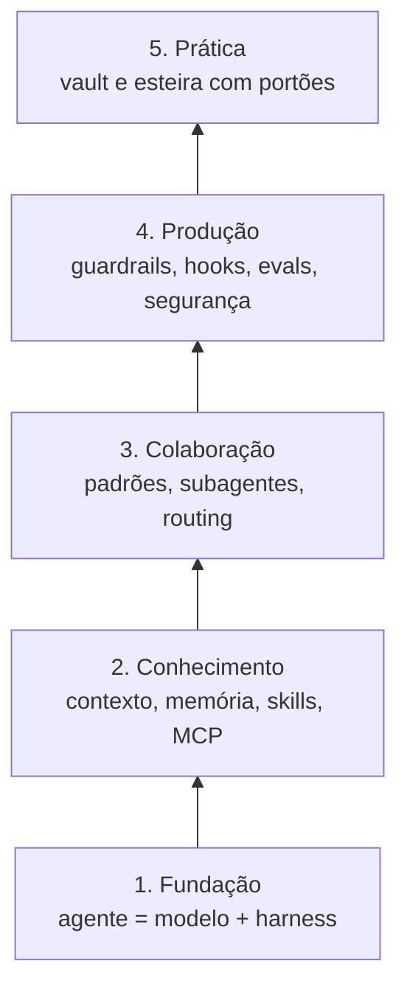

# Engenharia de IA na prática

Material de apoio da aula sobre engenharia de IA com o Claude Code. Cada conceito da aula tem aqui uma explicação curta **e** uma implementação que funciona: skills, subagentes, hooks, esteiras, evals e observabilidade. Há também um projeto pequeno para você praticar.

Para quem assistiu à aula e quer aplicar no próprio projeto.

> **A ideia central:** processo proporcional à tarefa. O padrão é o mais simples que resolve. A orquestração só entra quando se paga, e para saber se ela se paga é preciso medir.

## As cinco camadas

Cada camada resolve o limite deixado pela anterior.



## Conceito → onde ver

| Conceito | Explicação | Implementação |
|---|---|---|
| Loop do agente, harness | [docs/01_fundacao.md](docs/01_fundacao.md) | [exercício 1](exercicios/README.md) |
| CLAUDE.md como mapa | [docs/02_conhecimento.md](docs/02_conhecimento.md) | [CLAUDE.md](CLAUDE.md), [AGENTS.md](AGENTS.md) |
| Skills e divulgação progressiva | [docs/02_conhecimento.md](docs/02_conhecimento.md) | [.claude/skills/](.claude/skills/) |
| MCP | [docs/02_conhecimento.md](docs/02_conhecimento.md) | [.mcp.json.exemplo](.mcp.json.exemplo) |
| Subagentes e model routing | [docs/03_colaboracao.md](docs/03_colaboracao.md) | [.claude/agents/](.claude/agents/) |
| Guardrails e hooks | [docs/04_producao.md](docs/04_producao.md) | [.claude/hooks/](.claude/hooks/), [.claude/settings.json](.claude/settings.json) |
| Regra da catraca | [docs/04_producao.md](docs/04_producao.md) | [skill registrar-licao](.claude/skills/registrar-licao/SKILL.md) |
| Humano no loop e portões | [esteiras/](esteiras/README.md) | [skill planejar](.claude/skills/planejar/SKILL.md) |
| Evals e LLM como juiz | [evals/](evals/README.md) | [casos](evals/casos.md), [rubrica](evals/rubrica_juiz.md) |
| Observabilidade | [observabilidade/](observabilidade/README.md) | [telemetria.py](.claude/hooks/telemetria.py), [relatorio.py](observabilidade/relatorio.py) |
| Segurança | [seguranca/checklist.md](seguranca/checklist.md) | [bloquear_perigosos.py](.claude/hooks/bloquear_perigosos.py), [subagente seguranca](.claude/agents/seguranca.md) |
| Escala para o time | [plugin/](plugin/README.md) | [.claude-plugin/](.claude-plugin/plugin.json) |
| Segundo cérebro | [docs/05_pratica.md](docs/05_pratica.md) | [vault_exemplo/](vault_exemplo/CLAUDE.md), [skill handoff](.claude/skills/handoff/SKILL.md) |

## Em 5 minutos

Pré-requisitos: [Claude Code](https://code.claude.com/docs), git, Node 22+ e Python 3.

```bash
git clone https://github.com/<dono>/engenharia-de-ia-na-pratica.git
cd engenharia-de-ia-na-pratica
(cd exemplo && npm install && npm test)      # os testes passam
python3 .claude/hooks/test_hooks.py           # os hooks se comportam
python3 observabilidade/relatorio.py observabilidade/exemplo.jsonl
claude                                         # abra o Claude Code aqui
```

Na primeira vez, o Claude Code pergunta se você confia na pasta: as permissões e os hooks de `.claude/settings.json` só valem depois disso. Leia o arquivo antes de aceitar. É um bom hábito com qualquer repositório.

Depois peça, por exemplo: *"implemente o filtro por data do exemplo"*. O agente começa pela triagem, propõe um plano e espera o seu ok.

Só quer as skills e os hooks no seu projeto? Instale o plugin, dentro do Claude Code:

```
/plugin install ia-na-pratica --marketplace <dono>/engenharia-de-ia-na-pratica
```

Detalhes em [plugin/](plugin/README.md).

## Trilha de leitura

1. [docs/00_mapa.md](docs/00_mapa.md): visão geral (5 min).
2. [docs/01](docs/01_fundacao.md) a [docs/05](docs/05_pratica.md): uma camada por vez, cada uma termina com três perguntas.
3. [esteiras/](esteiras/README.md): rápida, padrão e completa, e quando usar cada uma.
4. [exercicios/](exercicios/README.md): um exercício por camada. O último é a feature de verdade.
5. Consulta: [glossário](docs/glossario.md), [perguntas frequentes](docs/perguntas_frequentes.md), [fontes](docs/fontes.md).

## Sobre os arquivos de configuração

JSON não aceita comentário. O que cada bloco de [.claude/settings.json](.claude/settings.json) demonstra está explicado em [docs/04_producao.md](docs/04_producao.md). O `.mcp.json.exemplo` só vira configuração se você copiar para `.mcp.json` (ignorado pelo git) e definir as variáveis `GITHUB_TOKEN` e `BANCO_DSN_SOMENTE_LEITURA` no seu ambiente.

Licença [MIT](LICENSE).
