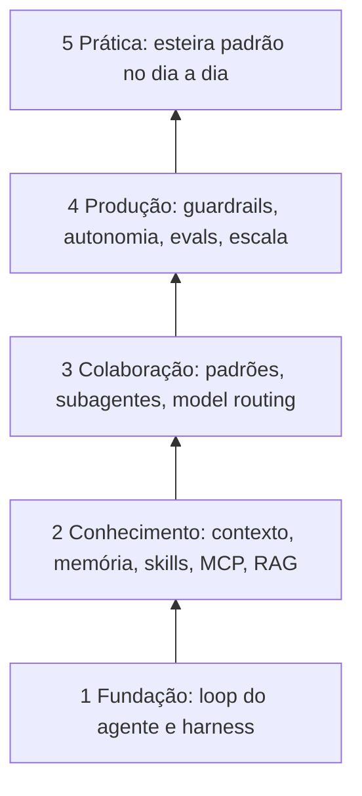

<!-- Conceito: mapa das cinco camadas da engenharia de IA, cada uma resolvendo o limite da anterior -->
# Mapa das cinco camadas

> Cada camada existe porque a anterior tem um limite. Entenda o limite e a camada seguinte deixa de parecer moda.

Este repositório é o material de apoio da aula "Engenharia de IA na prática". Ele usa o Claude Code como exemplo, mas a lógica vale para qualquer agente de código. A mensagem central cabe em três frases:

* O processo deve ser proporcional à tarefa.
* O padrão é o mais simples que resolve. Orquestração só entra quando se paga.
* Para saber se pagou, meça.

## Como ler o mapa

Pense em cinco andares. No térreo está o loop do agente. Cada andar acima resolve algo que quebrou no andar de baixo. Você não precisa subir até o topo em todo projeto: o certo é parar no andar mais baixo que resolve o seu problema.

## Tabela das camadas

| Camada | Limite que ela resolve | Limite que deixa |
| --- | --- | --- |
| 1 Fundação | Um modelo sozinho não executa nada e não tem estado. O loop com harness dá ferramentas e continuidade. | O agente age, mas esquece o projeto e enche o contexto de ruído. |
| 2 Conhecimento | O agente passa a carregar só o contexto certo na hora certa: skills, memória, MCP, busca. | Um agente só se perde em tarefas grandes e mistura papéis. |
| 3 Colaboração | Subagentes especializados com contexto limpo, padrões de fluxo e modelo certo para cada papel. | Mais agentes, mais risco: quem impede, mede e corrige os erros? |
| 4 Produção | Guardrails, hooks, níveis de autonomia, evals e escala do indivíduo à organização. | Falta o dia a dia: como juntar tudo sem virar burocracia? |
| 5 Prática | Uma esteira proporcional à tarefa, com portões humanos e medição. | O limite agora é seu: medir, ajustar e não inflar o processo. |

## Onde ver no repositório

* Visão geral e instalação: [README.md](../README.md)
* Regras para qualquer agente: [AGENTS.md](../AGENTS.md) e [CLAUDE.md](../CLAUDE.md)
* Projeto de exemplo usado nos exercícios: [exemplo/README.md](../exemplo/README.md)
* Vocabulário: [glossario.md](glossario.md)
* Dúvidas comuns: [perguntas_frequentes.md](perguntas_frequentes.md)
* Referências oficiais: [fontes.md](fontes.md)

## Trilha de leitura

1. [01_fundacao.md](01_fundacao.md): o loop, o harness, workflow contra agente.
2. [02_conhecimento.md](02_conhecimento.md): como o agente sabe o que precisa saber.
3. [03_colaboracao.md](03_colaboracao.md): quando dividir o trabalho entre agentes.
4. [04_producao.md](04_producao.md): como impedir, medir e corrigir.
5. [05_pratica.md](05_pratica.md): a esteira padrão em oito passos.
6. [../esteiras/README.md](../esteiras/README.md): as três esteiras e como escolher.
7. [../exercicios/README.md](../exercicios/README.md): coloque a mão na massa.

## Teste seu entendimento

1. Por que subir uma camada sem ter batido no limite da anterior costuma piorar o resultado?
2. Dê um exemplo de tarefa que fica bem resolvida só com a camada 1 e outro que exige chegar à camada 3.
3. Qual é a diferença entre "o processo é pesado" e "o processo é proporcional"?

**Próximo problema:** um modelo sozinho não faz nada. Como ele vira um agente? Siga para [01_fundacao.md](01_fundacao.md).
