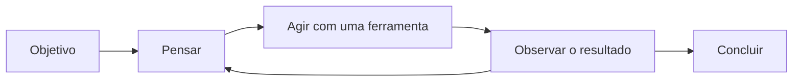

<!-- Conceito: camada 1, fundação. Loop do agente, modelo sem estado, Agente = Modelo + Harness, workflow contra agente -->
# Camada 1: Fundação

> Um modelo sozinho só gera texto. Agente é modelo mais harness: o loop, as ferramentas e as regras que o cercam.

## O loop do agente

Todo agente repete quatro movimentos: recebe um objetivo, pensa, age e observa o resultado. Depois volta a pensar com o que viu, até concluir ou desistir.

Exemplo no projeto de tarefas ([exemplo/](../exemplo/README.md)): o objetivo é "listar só as tarefas pendentes". O agente pensa ("preciso ver como `listar.ts` está escrito"), age (lê o arquivo), observa (vê `filtrarPorStatus`) e decide o próximo passo (rodar `npm test`). A cada volta, o que ele observa muda o que ele pensa.

### Um turno do loop, passo a passo

Veja o loop completo para o pedido "mostre só as tarefas feitas":

1. **Objetivo:** o usuário escreve o pedido em linguagem natural.
2. **Pensar:** o modelo decide que precisa conhecer o código atual antes de mexer.
3. **Agir:** ele chama a ferramenta de busca por `filtrarPorStatus`.
4. **Observar:** o harness devolve o trecho de `src/listar.ts` ao modelo.
5. **Pensar de novo:** ele nota que a função já aceita um status e que falta só um teste.
6. **Agir:** ele edita `test/listar.test.ts` e roda `npm test`.
7. **Observar:** os testes passam, e o modelo decide concluir.

Repare que o agente nunca "adivinha" o estado do código. Ele observa. Um agente sem observação é só um modelo escrevendo código às cegas.

### Quando o loop falha

O loop tem três jeitos clássicos de quebrar:

* **Não termina:** o agente repete a mesma ação sem progresso. Por isso existe o limite de tentativas e a regra de parar na segunda falha igual.
* **Observa mal:** a saída da ferramenta é enorme ou confusa e o modelo lê errado. Saídas curtas e erros claros ajudam.
* **Objetivo vago:** "melhore o código" não tem critério de fim. "Faça `filtrarPorData` passar nestes cinco casos de teste" tem.

## O modelo não tem estado e não executa nada

Duas verdades incômodas sobre o modelo:

* Ele não tem estado. Cada chamada começa do zero. Tudo o que ele "lembra" é o que foi colocado no contexto daquela chamada.
* Ele não executa nada. Ele devolve texto. Quando o texto diz "rode `npm test`", alguém precisa de fato rodar o comando e devolver a saída.

Esse "alguém" é o harness. Sem ele, o modelo pode escrever o código perfeito da função `filtrarPorData` e ainda assim nunca criar o arquivo.

Para o seu dia a dia, isso muda a forma de pedir. Em vez de descrever o código que você quer, descreva o resultado que você consegue verificar. O agente tem ferramentas para checar o resultado e pode iterar sozinho até acertar.

## Agente = Modelo + Harness

O harness é tudo o que não é o modelo: o loop, as ferramentas (ler, editar, rodar comandos), as permissões, os hooks, o carregamento do CLAUDE.md, o controle do contexto. É nele que mora a maior parte da engenharia.

A prova prática: **chat e Claude Code usam o mesmo modelo, com harness diferente.** No chat você cola um trecho e recebe uma sugestão. No Claude Code o mesmo modelo lê o repositório, edita arquivos, roda os testes e corrige o que quebrou. A diferença de resultado vem do harness, não da inteligência.

O que o harness faz, na prática:

* Monta o contexto da sessão: carrega o CLAUDE.md inteiro e as descrições das skills.
* Expõe as ferramentas: ler, buscar, editar, rodar comandos.
* Aplica as permissões: pergunta, nega ou deixa passar cada chamada.
* Dispara os hooks antes e depois das ferramentas.
* Mantém o loop rodando e decide quando parar.
* Registra o que aconteceu, quando há telemetria ligada.

Nada disso é "inteligência do modelo". É engenharia de software em volta dele, e é a parte que você controla.

## Workflow contra agente

Nem todo problema pede um agente. A regra prática: **se dá para escrever os passos antes, é workflow.**

| Característica | Workflow | Agente |
| --- | --- | --- |
| Passos | Escritos antes, em código ou roteiro | Decididos durante a execução |
| Previsibilidade | Alta | Menor |
| Custo e latência | Baixos | Maiores |
| Bom para | Rodar lint, testes e formatar a cada edição | Corrigir um bug cuja causa ninguém sabe |

No repositório, rodar o biome e o vitest depois de cada edição é workflow: sempre os mesmos passos, por isso virou um hook. Descobrir por que o filtro por data retorna uma tarefa a mais é trabalho de agente: o caminho depende do que ele for encontrando.

### Como decidir, na prática

Faça duas perguntas antes de montar qualquer coisa:

1. Eu consigo escrever a lista de passos agora? Se sim, escreva um script ou um hook. É mais barato, mais rápido e dá o mesmo resultado toda vez.
2. Se não, o que o agente precisa ver para escolher o próximo passo? Garanta que ele tenha essas observações (testes, logs, saída do lint).

Misturar os dois é normal e saudável: um agente decide o que fazer, e workflows fixos garantem o que acontece depois de cada edição.

## Arquitetura em camadas

Um sistema com agente se organiza em camadas que se apoiam: o modelo na base, o harness em volta, o conhecimento que o harness injeta, a colaboração entre agentes, as proteções de produção e, no topo, a prática diária. Este material segue essa ordem. Quando algo dá errado, procure a camada certa: um erro de "esqueceu a convenção" é de conhecimento, não de modelo fraco.

Uma regra para guardar: quando o resultado ruim aparece, pergunte primeiro "o que o harness poderia ter feito diferente?" e só depois "será que preciso de um modelo maior?". Quase sempre a primeira pergunta rende mais.

## Onde ver no repositório

* Regras que o harness carrega em toda sessão: [CLAUDE.md](../CLAUDE.md) e [AGENTS.md](../AGENTS.md)
* Configuração do harness (permissões e hooks): [.claude/settings.json](../.claude/settings.json)
* Workflow virando hook, depois de cada edição: [.claude/hooks/lint_e_testes.py](../.claude/hooks/lint_e_testes.py)
* Projeto sobre o qual o loop trabalha: [exemplo/src/listar.ts](../exemplo/src/listar.ts) e [exemplo/test/listar.test.ts](../exemplo/test/listar.test.ts)
* Escolha entre workflow e agente na prática: [esteiras/README.md](../esteiras/README.md)

## Erros comuns de quem está começando

* Achar que um modelo maior conserta um harness fraco. Sem ferramentas e sem verificação, o modelo maior só erra com mais confiança.
* Tratar o agente como chat: colar trechos e copiar respostas, quando ele poderia ler e testar sozinho.
* Dar tarefas sem critério de fim. O loop só para bem quando existe uma verificação clara.
* Construir um agente para algo que é um script de cinco linhas.

Um resumo para levar: o modelo pensa, o harness executa, e a qualidade do conjunto depende dos dois.

## Teste seu entendimento

1. Por que dizer que "o modelo não tem estado" muda a forma de pedir uma tarefa longa?
2. Cite duas coisas que o harness do Claude Code faz e que o chat comum não faz.
3. Você precisa formatar o código a cada commit. É workflow ou agente? Justifique em uma frase.

**Próximo problema:** o loop funciona, mas o contexto enche e o agente esquece. Veja como ele sabe o que precisa saber em [02_conhecimento.md](02_conhecimento.md).
