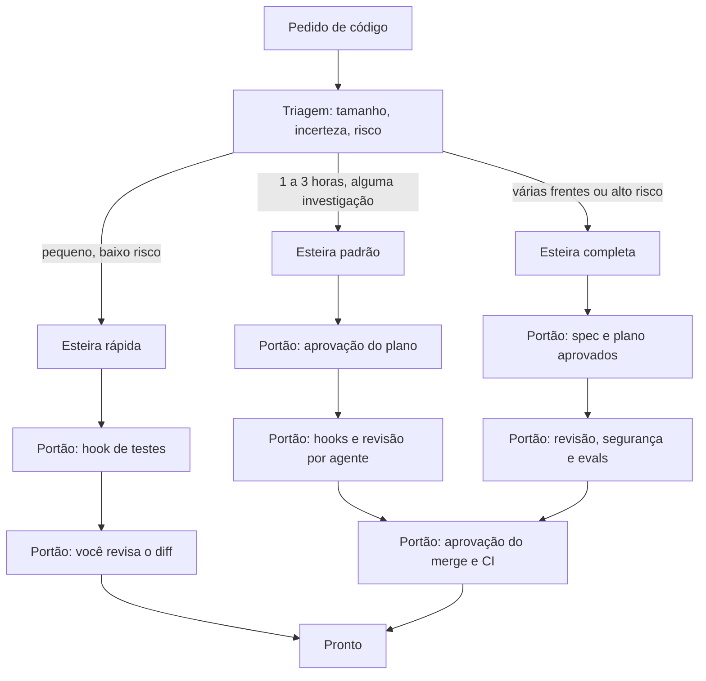

<!-- Conceito: esteira, fluxo proporcional à tarefa. A triagem escolhe a mais leve que resolve. -->
# Esteiras

Uma esteira é o fluxo de trabalho de uma tarefa: etapas, agentes e portões. O erro comum é usar o processo completo em tudo. Aqui a regra é a oposta: **processo proporcional à tarefa**. A [triagem](../.claude/skills/triagem/SKILL.md) mede a tarefa e escolhe a esteira mais leve que resolve.

## As três esteiras

| | [Rápida](rapida.md) | [Padrão](padrao.md) | [Completa](completa.md) |
|---|---|---|---|
| Tamanho | menos de 1 hora | 1 a 3 horas | vários dias |
| Incerteza | baixa, passos conhecidos | média, precisa investigar | alta, várias frentes |
| Risco | baixo | médio | alto ou zona sensível |
| Agentes | 1 (o principal) | principal, explorador, revisor | orquestrador, workers, revisor, segurança |
| Portões | hook de testes, diff revisado por você | aprovação do plano, hooks, revisão, aprovação do merge, CI | todos os da padrão, mais revisão de segurança, evals e limite de tempo |
| Quando usar | correção pequena, ajuste de texto, bug com causa clara | funcionalidade pequena, como o filtro por data | módulo novo, mudança que toca auth, dados ou várias áreas |

## Como a triagem decide

Três perguntas, nesta ordem:

1. **Tamanho:** quanto tempo levaria para um dev?
2. **Incerteza:** os passos são conhecidos ou há que investigar?
3. **Risco:** mexe em autenticação, dinheiro, dados pessoais ou infraestrutura?

Na dúvida entre duas esteiras, fique com a mais leve. Subir de esteira exige justificativa escrita.

## Pronto significa

Testado, com lint e build passando e CI verde. Nenhuma esteira dispensa isso.

## Conceitos usados

* [Níveis de autonomia](../docs/04_producao.md): a rápida fica entre o 2 e o 3, a completa tem mais portões porque o risco é maior.
* [Model routing](../docs/03_colaboracao.md): cada esteira usa o menor modelo que passa.
* [Medir](../observabilidade/README.md): é assim que você sabe se a esteira escolhida foi proporcional.

**Próximo problema:** a tarefa é pequena e você já sabe o que fazer. Veja a [esteira rápida](rapida.md).
