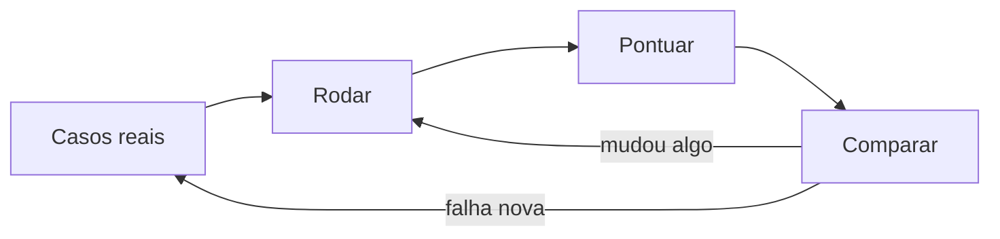

<!-- Conceito: eval, a medida de qualidade que diz se o agente melhorou ou piorou. -->
# Evals

Um eval é um teste de qualidade do agente. Teste de unidade diz se o código funciona. Eval diz se o agente, com este modelo, esta skill e este prompt, resolve tarefas reais do jeito que você precisa.

Sem eval, trocar o modelo, editar uma skill ou mexer no CLAUDE.md é aposta. Com eval, é comparação.

## O ciclo

1. **Casos reais.** Tarefas que você já fez ou vai fazer, com critério de aceite objetivo. Veja [casos.md](casos.md). Toda falha em produção vira um caso novo (regra da catraca).
2. **Rodar.** Execute o agente em cada caso, anotando esteira, modelo e tempo.
3. **Pontuar.** Dois jeitos: checagem determinística (os testes passam? o arquivo mudou?) e LLM como juiz para o que é subjetivo. Veja [rubrica_juiz.md](rubrica_juiz.md).
4. **Comparar.** Contra a execução anterior. Melhorou em qualidade e caiu em custo? Ficou igual e mais barato? Piorou em algum caso?

## Prefira o que dá para checar com código

Teste passa ou falha. Isso é barato, estável e sem opinião. Use o juiz só no que o código não consegue medir, como clareza do plano ou aderência às convenções.

## Como conecta com model routing

A regra é usar o menor modelo que passa no teste. O eval é esse teste. Rode os mesmos casos com Haiku, Sonnet e Opus e veja onde cada um passa. Se o Sonnet passa em tudo que o Opus passa, o Opus não se paga naquela tarefa. Sem eval, a escolha de modelo é palpite.

## Como conecta com autonomia

Os níveis de autonomia sobem quando o eval sustenta. Um agente que passa de forma estável nos casos de uma esteira pode ganhar menos portões nela. Um que falha em casos de segurança volta a precisar de aprovação a cada passo. A confiança sai de dados, não de impressão.

## Registro

Cada rodada vira uma linha na tabela do caso: data, esteira, modelo, tempo de relógio, tempo humano e resultado. Com a telemetria você tira o tempo de relógio do [relatório](../observabilidade/README.md).

## Armadilhas

* Casos que só você entende: escreva o critério para outra pessoa conseguir pontuar.
* Poucos casos: seis é um começo, não uma garantia.
* Medir só a média: um caso que piora pode ser o importante.
* Juiz igual ao gerador: veja os cuidados na rubrica.

**Próximo problema:** quais tarefas medir. Veja os [casos](casos.md).
